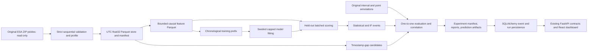

# Architecture

The source archive is the only large monolithic load: one trusted pickle is materialized at a time. Validation and Parquet conversion are bounded. Subsequent feature/model/evaluation stages stream batches and store only capped histories, training samples and event state. Feature outputs retain original UTC times, training/test boundaries and model parameters.

The default runner handles univariate statistical/Isolation Forest detection and separate timestamp gaps. Explicit PCA experiments require resampling and unit metadata; RF experiments require declared labels/negative assumptions. All detector fitting is chronological. Point events and all three benchmark categories remain represented.

Run locks, atomic file replacement, source fingerprints and derived SHA256 hashes protect resume. Completed channels are reused only when source, configuration, code and artifact integrity agree. A failed channel restarts at its beginning. Database publication uses one transaction per channel and replaces only that run/channel's rows, avoiding duplicate publication on resume without changing the existing schema.

The existing knowledge path is independent: document ingestion -> lexical retrieval -> optional Nebius chat. Tavily search supplies external research, never telemetry ground truth. Existing secrets remain server-side and the `.env` file is unchanged.

Detailed protocol, limits and commands: [MILESTONE1.md](MILESTONE1.md).
